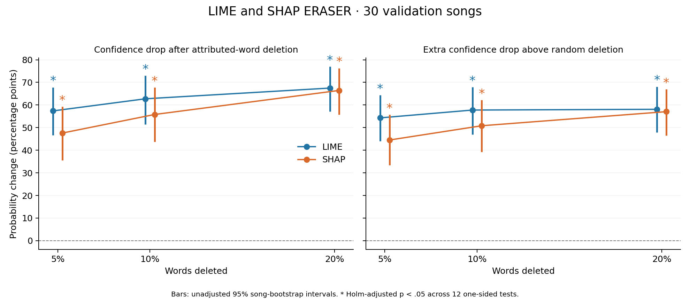

# LIME and SHAP ERASER analysis

Completed run: `20261113T082007192732Z`. Evaluated 30 stratified validation songs
with seed 67. Label allocation: {'Safe': 13, 'Mild': 10, 'Explicit': 7}.
All 180 song/method/deletion records passed consistency checks.

LIME used 1000 perturbations with positional
word deletion (`mask_string=''`). SHAP used 5
forward/backward permutation passes on positional word-presence features with
an empty-text background. The random control averaged
20 equal-count deletions per song and level.
The original local predicted class was held fixed for all scores.

## Confidence-drop results

| Method | Deleted | Mean drop (pp) | 95% CI (pp) | Random drop (pp) | Holm p: drop > 0 | Holm p: above random |
| --- | --- | --- | --- | --- | --- | --- |
| LIME | 5% | 57.39 | [46.67, 67.77] | 3.08 | 6.61424e-11 | 8.71834e-11 |
| LIME | 10% | 62.74 | [51.43, 72.96] | 4.98 | 1.60477e-11 | 6.61424e-11 |
| LIME | 20% | 67.48 | [57.18, 76.97] | 9.38 | 5.1478e-13 | 2.05701e-11 |
| SHAP | 5% | 47.60 | [35.54, 59.23] | 3.08 | 1.76472e-08 | 1.76472e-08 |
| SHAP | 10% | 55.80 | [43.73, 67.68] | 4.98 | 1.29165e-09 | 2.87782e-09 |
| SHAP | 20% | 66.44 | [55.71, 76.30] | 9.38 | 2.77487e-12 | 5.64019e-11 |

Drops are percentage points of the original local predicted-class probability.
Intervals are unadjusted 95% song-bootstrap intervals. P-values are one-sided
paired t tests with Holm correction across all 12 method/level/control tests.
The random control uses equal word counts and is shared between methods per song.

## Hypothesis interpretation

- LIME: corrected significant confidence drops at [5, 10, 20] percent deletion; corrected significant advantages over random at [5, 10, 20] percent deletion.
- SHAP: corrected significant confidence drops at [5, 10, 20] percent deletion; corrected significant advantages over random at [5, 10, 20] percent deletion.

Use the zero-control results for the stated hypothesis of a confidence reduction.
Use the random-control results for the stronger claim that highly attributed
words matter more than equally sized random word sets. A nonsignificant
comparison means insufficient evidence, not evidence of no effect.
Report each method and deletion level; do not pool repeated levels as independent songs.

## Exploratory method comparison

| Deleted | SHAP minus LIME (pp) | 95% CI (pp) | Holm p (two-sided) |
| --- | --- | --- | --- |
| 5% | -9.79 | [-21.05, -0.31] | 0.253913 |
| 10% | -6.94 | [-16.14, -0.01] | 0.253913 |
| 20% | -1.04 | [-5.23, 2.04] | 0.595359 |

Positive differences mean SHAP-guided deletion caused a larger drop. These
paired two-sided t tests use a separate Holm family of three comparisons.
The percentile intervals are descriptive and unadjusted; they use a different
procedure from the t tests and can disagree, especially for skewed paired
differences. Use the corrected p-values for the stated method-comparison decisions.
They describe this experiment and do not establish superiority across models,
explanation budgets, backgrounds, seeds, or datasets.

## Individual-song variation

| method | erasure_percent | songs_with_positive_drop | songs_beating_random |
| --- | --- | --- | --- |
| LIME | 5 | 29 | 28 |
| LIME | 10 | 30 | 29 |
| LIME | 20 | 30 | 30 |
| SHAP | 5 | 30 | 26 |
| SHAP | 10 | 30 | 30 |
| SHAP | 20 | 30 | 30 |

Counts use strict positive differences, before statistical testing.

## Diagnostics and limits

LIME local-fit R-squared: median 0.7436, range 0.2581 to 0.9529. Maximum absolute SHAP additivity residual: 5.96e-08. Additivity does not establish convergence or faithfulness.

Unique scored perturbations truncated at the model context limit:
0.
The evidence window reserves 24 BPE tokens, but deletion can change segmentation.
Any remaining truncations are part of the evaluated pipeline and can affect attributions.
The run reused 23 verified SHAP explanations;
its runtime truncation count covers newly scored texts only. A separate tokenizer-only
reconstruction of all SHAP permutation coalitions found 0
over-context texts among 77726 unique per-song
SHAP perturbations, including reused explanations. This audit reconstructs masks
with the recorded seed and budget; it does not recompute neural predictions.

These results concern the frozen hybrid model's fixed local evidence window,
after boundary trimming and retokenization. They do not establish full-song
faithfulness, visual quality, or fidelity
for every individual song. SHAP uses an empty-text background and five permutation
passes by default; convergence across explanation seeds/budgets was not tested.
LIME and SHAP use different approximation procedures. Both measure sensitivity
to word deletion, which may create unusual inputs. The small validation sample
and paired t-test assumptions limit generalization. Class breakdowns and the
separate three-test SHAP-versus-LIME analysis are exploratory.

The local predicted class differs from the full-song prediction for
1 of 30 songs. The local target is held fixed
through all deletions; this is intentional, but it further limits whole-song claims.

## Supporting files

- `faithfulness_statistics.csv`: primary tests and bootstrap intervals.
- `per_song_success_counts.csv`: number of songs with positive drops and above-random drops.
- `exploratory_shap_vs_lime.csv`: paired method differences, two-sided tests, Holm across three levels.
- `descriptive_by_actual_class.csv`: descriptive class breakdowns.
- `explanation_diagnostics.csv`: LIME fit and SHAP additivity checks.
- `song_*/explanations.html`: both methods' highlighted words; panels scaled independently.
