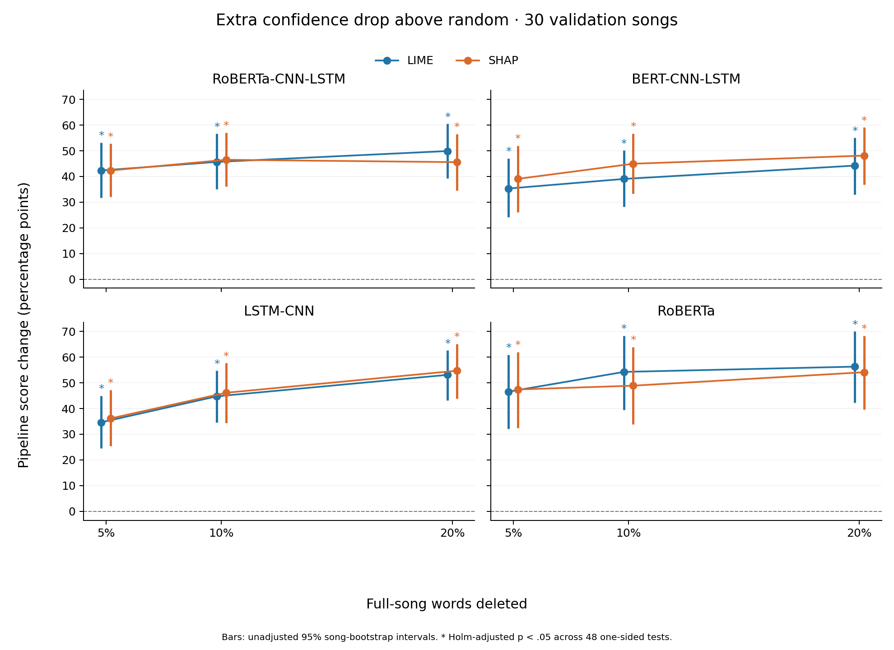

# Full-song LIME/SHAP ERASER analysis

Run `20261113T084837359932Z` evaluated all 30 previously selected validation songs
with 4 frozen models. All 720 method/deletion records passed
the paired-data, attribution-alignment, and additivity consistency checks.
The validation-label allocation was {'Safe': 13, 'Mild': 10, 'Explicit': 7}.

After global Holm correction, 24 of
24 attributed-versus-random comparisons and
24 of 24 positive-drop comparisons
were significant at alpha .05. The decisions below identify the supported
model, explanation method, and deletion levels.

## Decisions

| Model | Method | Significant drop levels | Significantly above random |
| --- | --- | --- | --- |
| hybrid | LIME | 5%, 10%, 20% | 5%, 10%, 20% |
| hybrid | SHAP | 5%, 10%, 20% | 5%, 10%, 20% |
| bert_cnn_lstm | LIME | 5%, 10%, 20% | 5%, 10%, 20% |
| bert_cnn_lstm | SHAP | 5%, 10%, 20% | 5%, 10%, 20% |
| lstm_cnn | LIME | 5%, 10%, 20% | 5%, 10%, 20% |
| lstm_cnn | SHAP | 5%, 10%, 20% | 5%, 10%, 20% |
| roberta | LIME | 5%, 10%, 20% | 5%, 10%, 20% |
| roberta | SHAP | 5%, 10%, 20% | 5%, 10%, 20% |

"Significant drop" tests whether the mean original-class score reduction is greater
than zero. "Above random" is the stronger specificity test: highly attributed
words cause a larger mean reduction than equal-count random deletions. Use both
columns when describing faithfulness. Failure to reject means insufficient
evidence, not evidence that the model selects tokens randomly.

## Effect sizes and statistical results

| Model | Method | Deleted | Drop (pp) | 95% CI (pp) | Random drop (pp) | Holm p: drop > 0 | Holm p: above random |
| --- | --- | --- | --- | --- | --- | --- | --- |
| hybrid | LIME | 5% | 48.96 | [38.05, 59.83] | 6.61 | 2.70446e-08 | 3.65488e-07 |
| hybrid | LIME | 10% | 56.59 | [45.67, 67.16] | 10.91 | 1.06283e-09 | 6.97277e-08 |
| hybrid | LIME | 20% | 62.21 | [51.67, 72.53] | 12.31 | 7.09403e-11 | 9.47232e-09 |
| hybrid | SHAP | 5% | 48.96 | [38.86, 59.09] | 6.61 | 7.55188e-09 | 1.58584e-07 |
| hybrid | SHAP | 10% | 57.41 | [46.87, 67.93] | 10.91 | 4.19774e-10 | 3.43749e-08 |
| hybrid | SHAP | 20% | 57.89 | [46.60, 69.15] | 12.31 | 1.5187e-09 | 1.01117e-07 |
| bert_cnn_lstm | LIME | 5% | 37.60 | [25.94, 49.91] | 2.29 | 4.08636e-06 | 4.08636e-06 |
| bert_cnn_lstm | LIME | 10% | 43.37 | [31.32, 55.44] | 4.32 | 8.105e-07 | 1.446e-06 |
| bert_cnn_lstm | LIME | 20% | 51.49 | [39.58, 63.16] | 7.26 | 6.27171e-08 | 1.9194e-07 |
| bert_cnn_lstm | SHAP | 5% | 41.36 | [28.46, 55.05] | 2.29 | 4.08636e-06 | 4.08636e-06 |
| bert_cnn_lstm | SHAP | 10% | 49.29 | [37.13, 61.58] | 4.32 | 1.9194e-07 | 3.65488e-07 |
| bert_cnn_lstm | SHAP | 20% | 55.39 | [43.13, 67.04] | 7.26 | 1.77104e-08 | 6.97277e-08 |
| lstm_cnn | LIME | 5% | 37.85 | [27.06, 48.71] | 3.21 | 1.15605e-06 | 2.56209e-06 |
| lstm_cnn | LIME | 10% | 48.26 | [38.00, 58.48] | 3.52 | 9.64175e-09 | 3.43829e-08 |
| lstm_cnn | LIME | 20% | 59.55 | [49.29, 69.49] | 6.45 | 7.21917e-11 | 4.27174e-10 |
| lstm_cnn | SHAP | 5% | 39.35 | [28.30, 50.76] | 3.21 | 1.54098e-06 | 3.40859e-06 |
| lstm_cnn | SHAP | 10% | 49.65 | [37.86, 61.19] | 3.52 | 7.02361e-08 | 1.9194e-07 |
| lstm_cnn | SHAP | 20% | 61.17 | [49.97, 71.87] | 6.45 | 2.81531e-10 | 1.62991e-09 |
| roberta | LIME | 5% | 48.09 | [32.64, 63.09] | 1.53 | 4.08636e-06 | 4.08636e-06 |
| roberta | LIME | 10% | 57.93 | [42.47, 72.69] | 3.67 | 3.32358e-07 | 4.51252e-07 |
| roberta | LIME | 20% | 63.64 | [49.35, 77.90] | 7.34 | 3.39914e-08 | 1.39929e-07 |
| roberta | SHAP | 5% | 48.94 | [34.01, 63.73] | 1.53 | 4.08636e-06 | 4.08636e-06 |
| roberta | SHAP | 10% | 52.56 | [36.57, 68.35] | 3.67 | 3.10292e-06 | 3.74451e-06 |
| roberta | SHAP | 20% | 61.47 | [45.88, 76.13] | 7.34 | 1.9194e-07 | 6.42393e-07 |

Values are percentage points. Tests are one-sided paired t tests across songs.
Holm correction treats all 48 requested model/method/level/control
comparisons as one family at alpha .05. Intervals are unadjusted 95% percentile
song-bootstrap intervals with 10000 resamples;
their procedure differs from the corrected tests. Repeated deletion levels are
not treated as independent songs. No between-model superiority test is performed.

## Changes in actual song predictions

| Model | Deleted | LIME label flips | SHAP label flips | Random label flips |
| --- | --- | --- | --- | --- |
| hybrid | 5% | 56.7% | 60.0% | 11.8% |
| hybrid | 10% | 66.7% | 66.7% | 16.8% |
| hybrid | 20% | 70.0% | 66.7% | 19.5% |
| bert_cnn_lstm | 5% | 50.0% | 50.0% | 2.7% |
| bert_cnn_lstm | 10% | 50.0% | 60.0% | 7.2% |
| bert_cnn_lstm | 20% | 63.3% | 66.7% | 10.7% |
| lstm_cnn | 5% | 53.3% | 53.3% | 4.7% |
| lstm_cnn | 10% | 60.0% | 63.3% | 4.8% |
| lstm_cnn | 20% | 73.3% | 73.3% | 8.7% |
| roberta | 5% | 46.7% | 50.0% | 2.0% |
| roberta | 10% | 60.0% | 56.7% | 5.0% |
| roberta | 20% | 66.7% | 66.7% | 9.3% |

These are descriptive label-change rates relative to the original song prediction,
not error rates against human labels. No separate hypothesis tests are performed
on these rates. Confidence reductions can occur with or without a label change.

## What was explained

Entire cleaned songs were explained without truncating them to an evidence window.
Every masked/deleted input was retokenized and all overlapping windows recomputed.
The original predicted class was the fixed target. The existing maximum-severity
pooler and evidence-window selection were rerun after every perturbation. Thus,
the evidence window and predicted label could change. The optimized unperturbed
scores were checked against the repository's original prediction function for
every model/song condition.

The measured score is the original target class probability in the dynamically
selected evidence window. It is the repository's full-pipeline output score,
not a calibrated probability that the whole song belongs to a class. This
distinction matters because severity pooling is discrete and window selection
can switch. The output also records actual song-label flips, alongside confidence
changes. This differs from the earlier fixed-local-window experiment.

LIME used 1000 actual word-deletion perturbations,
and SHAP used 5 forward/backward permutation
passes over positional word-presence features with an empty-text background.
Original whitespace was preserved before the common preprocessing function.
Rankings used signed target-class attributions in descending order. At each
5%, 10%, and 20% level, deletion counts were rounded up, retaining at least one
word. Rankings can include nonpositive attributions if too few positions have
positive support. 20 random deletions were averaged per
song and level. LIME and SHAP shared the same random controls, and all models
used the same song/position selections. Seed: 67.

## Explanation diagnostics

| model | median_lime_fit | minimum_lime_fit | max_shap_residual | unique_scored_texts | cached_scorer_windows |
| --- | --- | --- | --- | --- | --- |
| bert_cnn_lstm | 0.7079 | 0.0467 | 3.33e-16 | 138707 | 161229 |
| hybrid | 0.7459 | 0.2135 | 2.98e-08 | 138707 | 163034 |
| lstm_cnn | 0.7434 | 0.0636 | 1.49e-08 | 138706 | 153898 |
| roberta | 0.6701 | 0.0375 | 2.79e-08 | 138707 | 163032 |

Additivity checks verify bookkeeping, not SHAP convergence. Finite explanation
budgets, one explanation seed, surrogate fit variation, only 30 validation songs,
and the paired t-test assumptions limit generalization. Word deletion can create
unusual inputs. Faithfulness means attribution agreement with this model's
sensitivity; it does not establish semantic correctness or human-like intent.
Attributions can faithfully explain an incorrect prediction. Original-song
accuracy and Macro-F1 are saved as descriptive context, without testing the
model-performance hypothesis on this small validation sample.

## Files

- `original_predictions.csv`: all original full-song model predictions and pipeline scores.
- `explanations_index.html`: links to every model/song's complete-song visual explanations.
- `eraser_per_song.csv`: attributed/random effects and label flips.
- `faithfulness_statistics.csv`: every test, confidence interval, and corrected decision.
- `success_and_flip_rates.csv`: individual-song success counts and song-label flip rates.
- `hypothesis_decisions.csv`: compact decision table above.
- `descriptive_prediction_metrics.csv`: accuracy and Macro-F1 on these 30 validation songs only.
- `model/song_*/explanations.html`: both methods' complete-song highlighting.
- `methodology.json`: exact budgets, input hashes, score definition, and checkpoint provenance.
